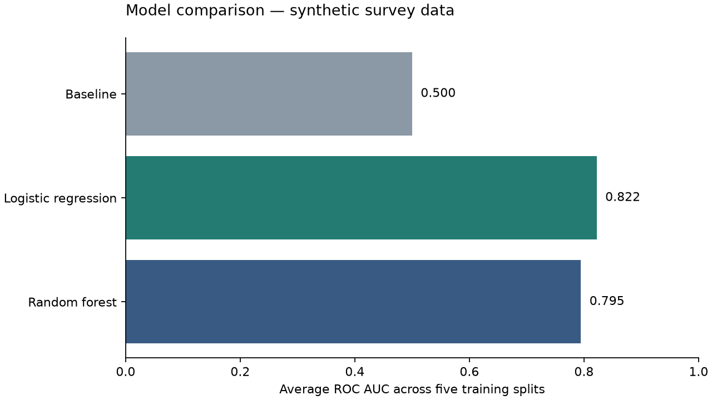

# Verified synthetic demo run

Run date: 12 October 2026. Python 3.11. 1,000 fictional records; seed 42; 800 training and 200 test records.

These scores demonstrate the software on generated data. They do not measure real customer behaviour.

| Model | CV accuracy | CV F1 | CV ROC AUC | Test accuracy | Test F1 | Test ROC AUC |
|---|---:|---:|---:|---:|---:|---:|
| DummyClassifier | 0.562 | 0.000 | 0.500 | 0.560 | 0.000 | 0.500 |
| LogisticRegression | 0.746 | 0.700 | 0.822 | 0.790 | 0.756 | 0.873 |
| RandomForestClassifier | 0.749 | 0.709 | 0.795 | 0.780 | 0.741 | 0.878 |

CV means the average across five training splits. Logistic regression has the highest average training-split ROC AUC in this run. Test results are shown for illustration, not used to tune settings.

Validation: the complete command-line run completed; two automated tests passed. Checks cover deterministic data generation, finite scores, saved-model loading through both prediction interfaces, training-only median calculation, missing values, and unseen categories.

Generated MLflow records and trained models stay local and are excluded from Git. Recreate them using the README commands.
